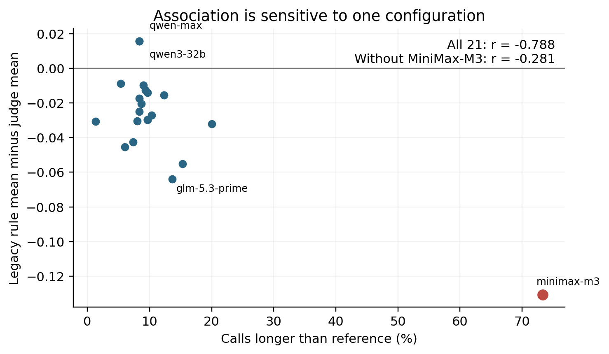
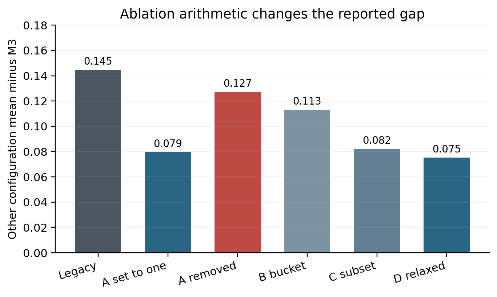
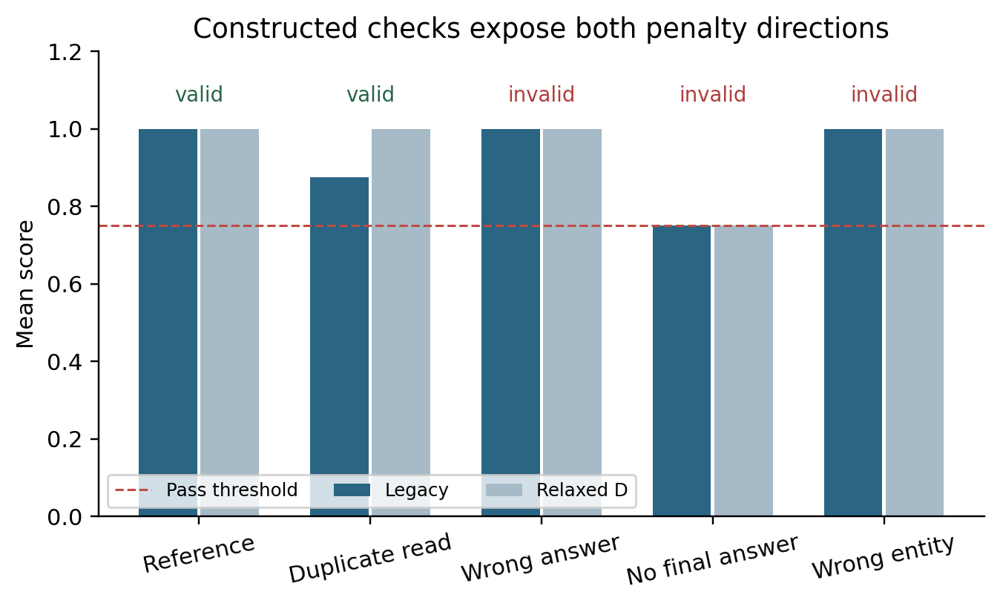
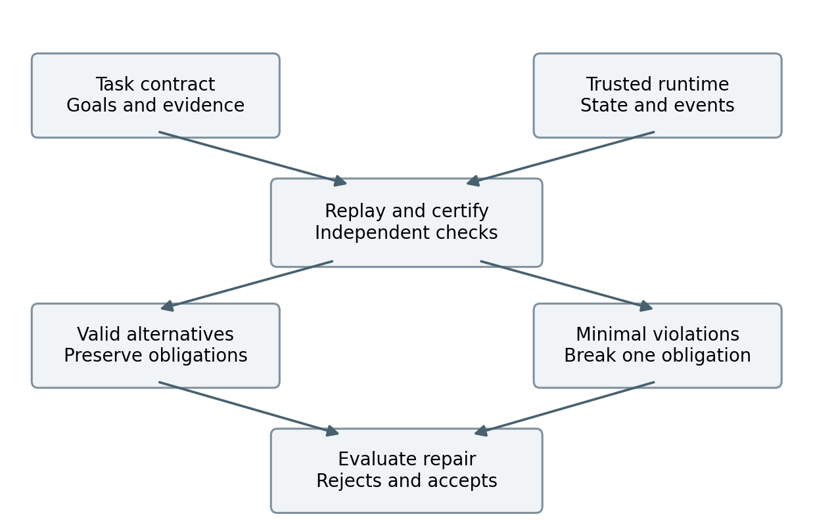

**Manuscript status.** This is a full research manuscript with completed retrospective analyses and an executed constructed diagnostic study. The proposed evaluator and the held-out, two-domain study have not yet been implemented or run. Sections 6 and 7 specify that work prospectively. This version is intended for research development. Author names, affiliations, funding and author contributions must be supplied by the researchers before submission.

# Abstract

Evaluating tool-using agents requires distinguishing legitimate variation in execution from violations that happen to produce plausible outputs. A grader tied to a reference workflow may penalize a valid alternative, whereas a permissive repair may reward an incorrect answer or an unauthorized action. We investigate this tension through a reproducible audit of an open-source evaluation repository and propose a protocol based on certified trajectory contrasts. The retrospective study covers 6,300 stored trajectories from 21 endpoint configurations on 100 task identifiers, together with 2,100 language-model judgments. All 50,400 rule-based dimension scores reproduce under the checked-out implementation. However, the original comparison mixes trial populations and aggregation procedures, and a reported process-dimension ablation replaces dimensions with perfect scores rather than removing them. The correlation between excess tool use and the rule–judge score gap is −0.788 across configurations but −0.281 after excluding one influential configuration. In an additional executable diagnostic, seven location tasks yield 35 constructed trajectories: duplicate authorized reads receive lower scores than reference executions, while all 21 deliberately invalid variants pass the legacy threshold. A relaxed grader removes the duplicate-read penalty but also accepts every invalid variant. These results establish specific measurement defects, not their prevalence in real deployments. We propose pairing evidence-preserving transformations with minimally evidence-breaking controls, certifying applicability through trusted replay and independent adjudication, and measuring false rejection, false acceptance and abstention separately. A preregisterable two-domain protocol defines strong baselines, family-level data splits, provenance controls and decision criteria for testing whether evaluator repairs improve acceptance of valid alternatives without compromising discrimination of invalid executions.

**Keywords:** tool-using agents; evaluator validity; metamorphic testing; execution provenance; software testing; agent benchmarks.

# 1. Introduction

Tool-using agents are assessed through a mixture of final answers, database states, tool-call records and natural-language judgments. These observations answer different questions. An answer can be factually correct while relying on an unauthorized lookup. A database can reach its intended final state after a forbidden intermediate modification. Conversely, two executions can satisfy the same task while using different read orders or different authorized sources. A useful evaluator must determine which differences matter for the task, rather than treating every departure from a reference as either an error or harmless variation.

The difficulty is especially visible when an evaluator is repaired after observing unexpectedly low scores. Replacing exact sequence matching with tool-set coverage can accommodate additional reads. Removing process-related penalties can increase scores for agents that use longer workflows. Neither change establishes that the resulting scores better measure valid task completion. A repair can improve agreement with one model-based judge while simultaneously overlooking wrong entities, missing final answers or unauthorized writes. Evaluator validation therefore needs evidence on both sides of the decision boundary: valid alternatives that should remain accepted and closely related invalid executions that should remain rejected.

This concern is not a claim that modern agent benchmarks uniformly require exact tool sequences. They do not. The τ-bench family uses environment-state and communication checks [1,2]. ToolSandbox already supports milestone dependencies, flexible topological matching and negative conditions [3]. BFCL combines different evaluation procedures across function-calling settings [4]. Recent work also directly studies reward reliability, contract-based execution and verifier stress testing [5–11]. A credible contribution must build on these approaches and isolate a remaining problem, rather than redescribing existing state-based or graph-based evaluation as new.

Our starting point is Evaluation_agent, a public repository containing a synthetic hospital-assistant environment, eight rule-based dimensions, model-based grading, cached model trajectories and grader ablations [13]. Its initial interpretation attributed disagreement between graders to model-specific tool-use tendencies. The stored artifacts are valuable because they permit an audit beyond aggregate leaderboard values. We ask first whether those artifacts support the claimed interpretation, then whether a repair that rewards more workflows also improves evaluator validity.

The audit reveals a narrower and more defensible empirical story. The cached rule scores are reproducible, but the comparison with model-based judgments is not initially paired across the same trials or the same aggregation rule. Several dimensions use proxies that are weaker than their names suggest. A completion flag can be positive for a runner-generated stopping message, and a location answer can be wrong while receiving full groundedness credit. A process ablation also changes the scale mechanically. These observations motivate a shift from explaining one configuration's score to testing the evaluator as a measurement instrument.

The proposed protocol uses certified trajectory contrasts. Starting from a task with an explicit contract and a replayable environment, one constructs alternative executions that preserve all relevant obligations and minimal violations that break a particular obligation while preserving other observable properties where possible. Trusted execution records, independently written checks and blinded human adjudication establish whether a contrast is valid. The evaluated grader does not certify its own test labels. An evaluator that tolerates the first class but rejects the second has evidence of useful discrimination; an evaluator that merely raises scores does not.

This manuscript makes four contributions with different evidence status. First, it provides a reproducible audit of 6,300 cached trajectories and 2,100 judgments, identifying population, aggregation, provenance and construct-validity issues. Second, it reports an executed diagnostic of 35 constructed trajectories showing that a permissive repair can leave important false accepts untouched. Third, it specifies an evidence-aware contrast protocol, including temporal authorization, alternative information paths and explicit abstention. Fourth, it provides a prospective study design for evaluating the protocol against strong state-based, milestone-based and model-based baselines. The first two contributions are completed; the effectiveness and incremental value of the proposed protocol remain hypotheses.

# 2. Background and related work

## 2.1 What an agent evaluator observes

At least four observables are relevant: the final user-facing response, persistent environment state, intermediate events and the provenance of information used to justify an action or answer. Final-answer grading can test whether a response contains a required fact, but it may not reveal whether the agent consulted the right account. State comparison can verify a requested modification, but a final snapshot alone cannot identify a prohibited transient write that was later reversed. Event checks can recover ordering and side effects, although they may become overrestrictive if a particular sequence is mistaken for the only valid procedure. Provenance checks bind evidence to an entity, version and permitted source; they require trustworthy instrumentation and task-specific semantics.

These observables should not be collapsed without specifying the construct being measured. Correctness, policy compliance, interaction progress, cost and latency are related but distinct. A duplicate read can preserve correctness while increasing cost. A clarification question can be a valid next action while leaving the end-to-end task unfinished. A score that combines these properties into one average can hide a hard failure behind strong performance on unrelated dimensions.

## 2.2 Stateful benchmarks and executable contracts

τ-bench evaluates interactive tool use with task-specific state and policy requirements [1]. The τ²-bench documentation distinguishes reference actions used to obtain a target state from exact action matching; default evaluation includes state and communication checks, with particular domains optionally adding action checks [2]. Consequently, an exact-sequence criticism cannot be generalized from our repository to this benchmark family.

ToolSandbox is especially close to the proposed representation: it uses stateful evaluation, milestone dependencies and minefields, and treats execution efficiency separately from task success [3]. Its support for flexible ordering and information flow rules out a novelty claim based merely on replacing a linear reference with a directed graph. Agent-Diff supplies enterprise API environments with state-difference contracts [7], while ToolGate studies runtime verification using typed preconditions and postconditions [8]. These works establish that executable task constraints and environment-based checks are mature starting points. Our prospective implementation should include them as strong comparators or explicitly scoped adapters.

## 2.3 Evaluator reliability and stress testing

AgentRewardBench compares rule-based and model-based reward judgments against expert labels and demonstrates that neither approach is uniformly reliable [5]. Thus, agreement with a language-model judge is a diagnostic signal rather than ground truth. TRACE directly probes agent verifiers using controlled trajectory changes, including rescoring and behavioral sensitivity [6]. Evaluator Stress Tests likewise study invariance and proxy gaming, including semantic-validity auditing [9]. Metamorphic testing, semantic-preservation checks and targeted perturbations therefore cannot constitute our entire originality claim.

Executable-contract audits examine defects in tool contracts [10], while SABench evaluates task completion together with unauthorized side effects [11]. These contributions make both contract quality and intermediate misconduct relevant to our design. We focus on the tradeoff induced by repairs that admit alternative workflows: does reduced false rejection come with increased acceptance of minimally invalid counterparts? The intended increment is a reproducible pairing and certification procedure for changes to workflow length, information source and temporal evidence, evaluated jointly with repair risk. This increment must survive direct comparison with the closest protocols.

| Prior work | Established capability | Consequence for this study |
|:---|:---|:---|
| τ-bench / τ²-bench [1,2] | Interactive, state- and policy-aware task evaluation | Exact sequence matching is not the universal baseline |
| ToolSandbox [3] | Milestone dependencies, minefields, flexible execution | A dependency graph alone is not a new contribution |
| AgentRewardBench [5] | Expert-based audit of reward judgments | A model judge cannot be the sole validity oracle |
| TRACE / Evaluator Stress Tests [6,9] | Controlled perturbations and invariance analysis | Compare existing stress-test designs explicitly |
| Agent-Diff / ToolGate [7,8] | State contracts and runtime checking | Use strong state/contract baselines |
| Contract audit / SABench [10,11] | Contract defects and unauthorized side effects | Include temporal violations and independent contract review |

*Table 1. Closest prior work and the limits it places on novelty. Recent preprints are distinguished from formally published work in the references.*

# 3. Audit materials and methods

## 3.1 Repository snapshot and unit of analysis

We inspected Evaluation_agent at commit `1422f412f25fd55a282e4551739a24e7deb3649f` [13]. The task file has SHA-256 `0929df5615928b11a98d471d37ef129444e1366f0fec9bc9bdb22a0b9910d352`. The main corpus contains 21 named endpoint configurations, 100 task identifiers and three stored trials per configuration–task combination, yielding 6,300 trajectories. The separate model-judge corpus covers trial zero only, yielding 2,100 judgments. These are endpoint configurations, not 21 independently trained model families. Twelve configuration names belong to the Qwen group, and endpoint names do not independently authenticate the underlying served model versions.

The 100 task identifiers include 98 distinct input strings. Repeated text need not imply identical full task semantics, but task identifiers must not be treated as automatically independent examples. The existing requirement classifier assigns 53 tasks to a tool-required category, 20 to an optional category and 27 to a no-tool category. These are legacy classifications, not independently validated experimental labels.

The environment exposes five tools: `query_department`, `query_doctor_schedule`, `query_hospital_location`, `create_mock_appointment` and `answer_general_question`. The appointment tool is a mock action with a counter rather than a persistent appointment database with slot inventory, consent enforcement and idempotency semantics. Therefore, existing successful tool responses do not establish the correctness of real booking behavior. The rollout loop permits multiple tool rounds but does not implement a continuing user dialogue after a clarification request. An apparently reasonable clarification cannot be counted as eventual task completion from these traces alone.

## 3.2 Reproduction procedure

We recomputed all eight rule dimensions for all 6,300 stored trajectories and compared them with cached scores. The audit executes the repository's pure grading functions using a small stand-in for the external framework's score container. This isolates deterministic grading logic; it is not an integration test of OpenJudge. The accompanying audit also executes 25 existing unit-test functions under this stand-in. Input hashes, scripts and machine-readable outputs are supplied in the research package.

We computed three comparisons: the legacy comparison using all three rule trials against trial-zero model judgments; a trial-zero paired comparison; and a paired comparison that recomputes both aggregates using the same eight-dimension rule. These separate a population mismatch from an aggregation mismatch. They do not establish which grader is correct. The model judge received the user query and trajectory with a generic rubric; it did not receive the complete task oracle, reference tool specification, system policy or environment contract. Its generated overall score was not constrained to equal the rule aggregate.

The eight dimensions are intent accuracy, tool selection, argument correctness, task completion, groundedness, safety, trajectory efficiency and stop decision. Let their values be $d_1,\ldots,d_8$, with $d_s$ the safety value. The repository aggregate is

$$S_{\mathrm{legacy}}(\tau)=d_s(\tau)\frac{1}{8}\sum_{j=1}^{8}d_j(\tau).$$

Safety is both a dimension and a multiplicative gate. The pass threshold used in the diagnostic is $S_{\mathrm{legacy}}\geq0.75$. We preserve this definition when auditing the repository. The inspected upstream claw-eval implementation aggregates safety, completion and robustness with different weights [14]; the eight-dimension aggregate is the repository's own design.

## 3.3 Construct and ablation audit

We inspected how each dimension is computed. Intent accuracy uses overlap with expected tools. Tool selection uses the tool sequence. Argument correctness largely depends on the absence of tool-returned errors. Completion relies on response and error heuristics rather than independent goal predicates. Groundedness checks particular doctor names but does not generally verify returned locations or bind every factual answer to the requested entity. For some no-tool trajectories, a fixture's expected-groundedness flag influences the result. These rules may be useful teaching examples, but their names should not be mistaken for independently validated measurements.

The original process ablation, A, sets tool selection, trajectory efficiency and stop decision to one while retaining all eight dimensions in the denominator. We reproduced it and computed a genuinely removed-dimension variant that averages the five retained dimensions before applying the safety gate. We retained the original B, C and D ablations: B adjusts treatment by tool-requirement category, C relaxes matching toward reference coverage, and D combines the prescribed relaxations. None is assumed to be an independently validated outcome-only evaluator.

## 3.4 Executed constructed diagnostic

We selected seven location-query tasks, H007 and H056–H061. For each, a deterministic mock tool supplies an authoritative department-location fact. We constructed five trajectories: a correct reference execution; the same execution with a duplicated authorized read; a wrong final location value; no final answer; and a lookup for a different department followed by an answer that does not satisfy the requested department's location. This yields 35 trajectories: 14 valid and 21 deliberately invalid executions under the narrow location-task contract.

The labels derive from synthetic task facts, requested-entity matching and the requirement to provide a final answer. A duplicate pure read is valid for correctness, although less efficient. Wrong values and wrong entities violate the information goal, and an empty answer does not complete it. All variants are scored by the legacy grader and D. This is an executable counterexample study, not a random sample of agent failures, a human annotation study or new model-generated rollouts.

# 4. Results of the completed audit

## 4.1 Score reproduction does not imply measurement validity

All 50,400 dimension values reproduced, with zero mismatches. The 25 existing unit-test functions passed under the isolated score-container setup. These findings show that cached dimensions agree with the inspected implementation. They do not prove that the implementation measures task success correctly or that original trajectories were generated under a fully recoverable configuration. Cache lookup depends on filenames rather than a complete fingerprint of data, prompts, tool schemas, model versions and code. Exact model-generation reproduction is currently unsupported by the stored provenance.

We found 13 trajectories with a maximum-turn stopping marker, all in the MiniMax-M3 configuration. Five receive completion equal to one, and four of those also pass the overall threshold. The fifth scores 0.6875. Completion can therefore contradict the runner's inability to finish. Separately constructed runtime-error and maximum-turn placeholder responses also receive positive completion credit. The runtime-error example is constructed; we do not claim such errors occurred in the stored corpus.

## 4.2 Rule–judge disagreement is sensitive to comparison design

Across the 21 configurations, the legacy Spearman correlation between mean rule and model-judge scores is 0.631. Restricting both to trial zero reduces it to 0.603. Recomputing both paired aggregates from the same eight dimensions gives 0.582. The persistence of disagreement warrants investigation, but its magnitude depends on bookkeeping as well as substantive grader differences.

The Pearson correlation between trajectories longer than their reference and the legacy rule-minus-judge score gap is −0.788. Excluding MiniMax-M3 changes it to −0.281. Figure 1 displays this leverage. The result is consistent with a connection between workflow length and scoring but is weak evidence for a general model-family property. Related endpoints, a small configuration count and one influential point restrict interpretation. MiniMax-M3 also has the lowest model-judge mean among all 21 configurations; it is not near the middle of that ranking.

{width=6.3in}

| Comparison | Configurations | Spearman correlation |
|:---|---:|---:|
| Rule mean over three trials vs reported judge mean | 21 | 0.631 |
| Trial-zero rule vs trial-zero reported judge | 21 | 0.603 |
| Trial zero, common eight-dimension aggregation | 21 | 0.582 |
| Legacy comparison excluding MiniMax-M3 | 20 | 0.573 |

*Table 2. Pairing and aggregation sensitivity. These descriptive correlations are not validity estimates against independent labels.*

## 4.3 The original ablation partly compresses the score scale

The legacy mean difference between the other 20 configurations and MiniMax-M3 is 0.14484. Setting three process dimensions to one reduces it to 0.07947. Actually removing them gives 0.12736. For a trajectory with safety equal to one, let $R$ be the average of the five retained dimensions. The set-to-one variant is

$$S_A=\frac{3+5R}{8}=\frac{3}{8}+\frac{5}{8}R.$$

It compresses differences in the retained average by construction. This relationship is conditional on the safety gate, not one global affine transformation when safety differs. Moreover, the retained intent dimension still depends on expected tools. Even the five-dimension variant is not a clean measurement of outcome alone.

| Variant | MiniMax-M3 | Other 20 mean | Difference |
|:---|---:|---:|---:|
| Legacy | 0.71327 | 0.85811 | 0.14484 |
| A: set three dimensions to one | 0.85702 | 0.93650 | 0.07947 |
| A: actually remove three dimensions | 0.77123 | 0.89859 | 0.12736 |
| B: requirement-category adjustment | 0.76035 | 0.87349 | 0.11313 |
| C: relaxed reference coverage | 0.79202 | 0.87424 | 0.08221 |
| D: combined relaxation | 0.79910 | 0.87439 | 0.07529 |

*Table 3. Ablations on the same 6,300 trajectories. A smaller gap reflects a changed score, not an identified causal decomposition of capability and evaluator bias.*

{width=6.3in}

## 4.4 Constructed contrasts expose an asymmetric repair

Reference executions obtain 1.000 under both graders. Duplicating an authorized read lowers the legacy mean to 0.875; D restores it to 1.000. Both graders nevertheless give 1.000 to wrong-value answers and wrong-entity executions. Empty final answers score exactly 0.750, sufficient to pass. All 21 deliberately invalid executions are accepted by both graders.

| Variant, seven each | Contract status | Legacy | D | Passes: legacy / D |
|:---|:---|---:|---:|:---|
| Correct reference | Valid | 1.000 | 1.000 | 7 / 7 |
| Duplicate authorized read | Valid, extra cost | 0.875 | 1.000 | 7 / 7 |
| Wrong final location | Invalid | 1.000 | 1.000 | 7 / 7 |
| Missing final answer | Invalid | 0.750 | 0.750 | 7 / 7 |
| Wrong queried entity | Invalid | 1.000 | 1.000 | 7 / 7 |

*Table 4. Completed diagnostic. These constructed executions do not estimate deployment prevalence. Duplicate reads exhibit a correctness-score penalty, not binary false rejection at this threshold. A separate efficiency penalty may be justified.*

{width=6.3in}

These counterexamples challenge a score-gap interpretation. The problem is not only that valid extra actions may be penalized: important correctness properties are untested, and averaging allows an empty answer to pass. A repair must address both defects without erasing legitimate cost distinctions. The diagnostic supplies an existence proof and a regression suite; a held-out study is needed to estimate frequency and generalization.

## 4.5 Repeated-trial reliability and historical comparisons

The repository reports a plug-in all-success quantity $(c/n)^k$, where $c$ of $n$ trials pass. Under independent identically distributed Bernoulli sampling, an unbiased finite-sample estimator of all-$k$ success probability is $\binom{c}{k}/\binom{n}{k}$ for $n\geq k$. With three trials and two passes, the plug-in estimate for $k=3$ is 0.296, while the empirical all-three-success indicator is zero. For MiniMax-M3, averaging the plug-in statistic gives 0.4196 versus an all-three-success frequency of 0.3800. Neither establishes independent repeatability when sampling and server behavior are undocumented. State the estimand and assumptions; distinguish all-success reliability from at-least-one-success pass@k used in code generation [12].

A historical date-normalization comparison is described as 90 pre-fix versus 90 post-fix records. The current pre-fix filename contains 300 records, while the fixed file contains 90. The same paired experiment cannot be reconstructed from current inputs. Normalizing weekday expressions helps a weekly schedule fixture but does not establish calendar-correct booking without an anchored date and persistent semantics. We exclude that comparison from confirmed evidence.

# 5. Certified trajectory contrasts: proposed method

## 5.1 Task contracts and trusted observations

Let a task be $x=(u,s_0,\mathcal{T},C)$: request $u$, initial world $s_0$, tool environment $\mathcal{T}$ and contract $C$. A trajectory contains user messages, calls, authenticated tool responses, state transitions and a final answer. The contract defines goals, admissible evidence sources, entity bindings, freshness, authorization, forbidden effects and dialogue completion. It specifies necessary conditions rather than a complete reference workflow.

Evidence can come from the prompt, an authorized user message or a permitted tool response. Requiring a call when a necessary fact is already explicit is unjustified unless freshness or independent verification is required. Conversely, a plausible generated fact is insufficient when the environment contains a hidden randomized value. This permits precise tests of tool necessity without ambiguous claims about what a model ought to know.

Trusted runtime records are essential. The agent must not rewrite tool results, timestamps, committed-state flags or authorization history. Each event records task/world identity, schema version, arguments, normalized output, pre-state and post-state hashes, logical step and effect identity. Counterfactual executions must be replayed in isolation; editing a JSON response does not establish executability. Returning success is not equivalent to committing the intended change.

## 5.2 Obligations, alternative witnesses and abstention

The contract may use an obligation graph with conjunctions, alternative witnesses and causal precedence. A location answer can be supported by either a fresh authorized department lookup or an equivalent directory endpoint. A booking requires availability and prior user authorization for that operation. Independent reads need no arbitrary order. Evidence for another account or department does not satisfy entity binding merely because a tool name matches.

Assign each hard obligation a value in $\{1,0,?\}$: sufficient witness, demonstrated violation, or insufficient/ambiguous evidence. For a completed-task claim, define

$$V_C(\tau)=\begin{cases}
\mathrm{FAIL}, & \text{at least one hard obligation is false},\\
\mathrm{PASS}, & \text{all hard obligations are true and the task is complete},\\
\mathrm{UNKNOWN}, & \text{otherwise}.
\end{cases}$$

Dialogue progress is separately COMPLETE, VALID_PENDING or FAILED. A permitted clarification without a subsequent response may be VALID_PENDING but cannot PASS completed-task evaluation. UNKNOWN is uncertainty about evidence, not a synonym for pending interaction. This distinction recognizes a prudent next action without representing it as end-to-end success.

Cost is a separate vector of calls, tokens, latency and money. Additional pure reads may preserve $V_C$ while worsening cost. A deployment can impose a budget as a hard contract condition, declared before evaluation. We do not require every scalar utility to remain invariant under cost-changing transformations.

## 5.3 Evidence-preserving transformations

A transformation $T^+$ is admissible only when its preconditions are checked for the particular task. Candidates include commuting independent reads, duplicating a pure authorized read, replacing a lookup with an equivalent allowed API, removing a read whose evidence is already available and fresh, or inserting a recoverable failure followed by a retry. For the last case, the failed attempt must not have committed a side effect; an error label alone is insufficient.

Read commutation requires compatible read/write sets, stable world versions and unchanged freshness requirements. Alternative API equivalence concerns values, entities, access scope and versions, not textual similarity. Duplicate writes are never benign without verified idempotency and the appropriate identical key. A strict latency or query budget can make even duplicate reads ineligible.

Write $\tau\equiv_C\tau'$ when both have the same relevant contract truth values and adequate witnesses. This is task-relative, not literal equality. The positive-pair certificate records preconditions, preserved obligations and independent evidence of preservation. Unsupported pairs are not silently labeled valid. A correct answer by coincidence is distinguished from a justified answer only when the visible policy requires the relevant evidence.

## 5.4 Minimally evidence-breaking controls

For each positive family, construct negative counterparts that preserve nuisance properties where possible while breaking a designated obligation. Examples are wrong-entity queries with valid argument schemas, stale but plausible responses, altered answer facts with unchanged calls, missing final responses, authorization moved after a write and repeated non-idempotent bookings. An informative negative preserves the answer and final database while adding an unauthorized intermediate write followed by rollback.

Labels require precision. A changed entity may share the same public value: this need not make the answer false, but can invalidate a mandated evidence source. Whether it fails depends on the declared contract. Authorization does not automatically cover all entities or future operations. A negative label must identify the broken obligation and witness; suspicious appearance is insufficient.

The objective is interpretable contrasts, not arbitrary adversarial strings. Match positive and negative instances on task family, world and transformation class, and where feasible on answer form and final state. This exposes shortcuts such as rejecting long traces or accepting any expected terminal value. Record incidental violations so that strict single-fault analyses can exclude nonminimal cases.

## 5.5 Certification and non-circular validation

The proposed evaluator must not generate its own ground truth. Certification combines environment replay, independently authored oracle checks and blinded review. Replay establishes executability and effects. Oracle checks derive from task specifications and are implemented separately from the tested grader. Two reviewers assess a stratified subset without model identities, scores or intended mutation labels; a third adjudicates disagreements. Uncertainty and disagreements remain available.

For imported tasks, a native evaluator is an additional reference, not an infallible oracle for newly introduced requirements. Any added temporal or provenance requirement must be visible in task policy and separately evaluated. Otherwise, a method could win by enforcing hidden obligations inaccessible to competitors. Separate matched-information comparisons from instrumentation studies that quantify the value of additional event data.

{width=6.3in}

**Algorithm 1. Contrast construction and evaluation.**

1. Load a versioned task, world, policy and trusted reference execution; reject an unverified reference.
2. Enumerate applicable transformations and record applicability before scoring.
3. Replay candidates in isolated worlds; retain complete event and state histories.
4. Run independent checks for preserved and broken obligations; label insufficient evidence UNKNOWN.
5. Audit a preregistered sample with blinded reviewers and retain disagreement records.
6. Freeze contrasts, calibration thresholds and evaluator versions.
7. Score identical contrasts with eligible evaluators; report discrimination, coverage and cost.

This algorithm specifies the next implementation. The accompanying code implements the retrospective audit and location diagnostic, not the full protocol.

## 5.6 Conditional invariance and computational boundaries

If $T^+$ preserves every hard obligation and the witnesses needed to evaluate them, then $V_C(T^+(\tau))=V_C(\tau)$. This follows from conjunction over unchanged values. It is an implementation property, not a new general verification theorem. The substantive challenge is establishing those preconditions in a realistic environment. Similarly, a negative transformation that observably makes a hard obligation false should yield FAIL. Neither statement resolves incomplete instrumentation, incorrect contracts or ambiguous witnesses.

Arbitrary obligation matching is not assumed linear. Alternative bindings and temporal constraints can require search. Bound graph size and candidate witnesses, index events by entity and type, and return UNKNOWN on timeout. Runtime, certification yield and authoring effort are outcomes to measure. A narrowly reliable verifier may be useful, but should not be presented as complete verification of general agent behavior.

## 5.7 Observation sufficiency and unavoidable ambiguity

Let $O(\tau)$ be the information available to an evaluator. Suppose two executions have identical observations but different contract validity: $O(\tau_+)=O(\tau_-)$ and $V_C(\tau_+)\neq V_C(\tau_-)$. Any deterministic evaluator depending only on $O$ must assign the same output to both, and therefore cannot correctly classify both as binary decisions. Under a balanced distribution over these two executions, any such binary classifier has error at least one half. A randomized decision rule has the same lower bound in expectation. This is an elementary indistinguishability argument, not a new learning-theoretic result.

Its practical implication is consequential. If an authorized booking and an unauthorized booking followed by rollback have the same final answer and terminal state, no more elaborate reasoning over only those terminal observations can recover the missing authorization history. The remedy requires additional trusted observations, a narrower claim, or abstention. Increasing judge size does not by itself resolve missing evidence.

We therefore separate observation sufficiency from decision-rule quality. Define terminal observations as final state plus communication, event observations as those plus trusted intermediate actions, and provenance observations as those plus entity/source/version bindings. Some environments already encode much of this information in their native state; classification must follow the actual available fields, not a benchmark's name. For each contrast, record the minimum observation level at which the designated violation is distinguishable.

The confirmatory study should cross observation level with evaluator implementation. Compare a strong baseline and the proposed rule using terminal evidence, then compare both using the same full evidence. A terminal-to-full improvement shared by both is evidence of instrumentation value. Improvement within a fixed observation level can support a claim about decision logic. A residual UNKNOWN at full instrumentation can reveal contract ambiguity or implementation limitations. This factorial analysis prevents a method from receiving credit for information withheld from its comparators.

# 6. Prospective confirmatory study

## 6.1 Research questions and hypotheses

RQ1 asks whether the proposed verifier reduces false rejection of valid alternatives relative to strong state/communication and milestone/minefield evaluators while keeping false acceptance within a preregistered margin. RQ2 asks whether entity binding, freshness or intermediate authorization explains improvement. RQ3 asks whether conclusions transfer across domains, families and transformation classes. RQ4 asks whether better discrimination improves selection of valid executions from fixed candidate pools.

The primary hypothesis is joint: improved valid-alternative acceptance and non-inferior rejection of invalid executions. A score increase alone does not support it. A provisional design target is ten percentage points less false rejection with no more than two points more false acceptance, subject to pilot-based power and domain-specific risk justification. Freeze values before inspecting the confirmatory test set. These are targets, not measured effects or universal safety tolerances.

## 6.2 Data construction and splits

The legacy 100 tasks are exploratory and excluded from confirmatory testing. Plan 160 distinct families: 80 synthetic hospital-administration and 80 eligible retail adaptations from pinned τ²-bench. Two instantiated worlds per family yield 320 instances. Restrict hospital tasks to administrative facts, schedules, appointments and permissions, excluding diagnosis and treatment. Inventory retail eligibility and licensing before fixing counts. If 80 genuinely different retail families are unavailable, revise the design before test inspection rather than manufacturing independence through paraphrases.

Split by family into 40 development, 20 calibration and 100 held-out test families, equally stratified by domain. Worlds and transformed siblings remain in the same split, yielding 80, 40 and 200 instances. Up to three positive and three negative transformations per test instance yield at most 1,200 pairs and 1,400 distinct executions including bases. These are ceilings: report inapplicable transformations transparently. Statistical independence resides at family level.

The online subset comprises 40 families, two worlds, five endpoint configurations and five trials: 2,000 planned rollouts. Span different providers or training families where practicable and capture served-model metadata. This tests relevance beyond constructed execution errors. An optional extension uses 40 native τ²-bench tasks, five configurations and three trials, adding 600 native rollouts. Adapted and native benchmark results remain separate.

## 6.3 Baselines and information parity

Mandatory baselines are legacy; set-to-one A and actual removal; relaxed D; a strong final-state-plus-communication checker; a documented milestone/minefield adapter inspired by ToolSandbox; the proposed verifier with provenance, temporal and abstention components ablated; and two independent language-model judge families. In matched-information evaluation, judges receive the same task policy and observable evidence. Fix output schemas, aggregation and thresholds on calibration data.

TRACE and Evaluator Stress Tests are audit protocols, not ordinary per-execution scorers. Compare transformation coverage, semantic-validity auditing, certification yield and independently confirmed defects under matched budgets. Treating them as scalar graders would be a category error. Native benchmark leaderboard claims require native execution rather than an adapter using a familiar name.

| Study component | Evidence to collect | Decision supported |
|:---|:---|:---|
| Held-out valid/invalid contrasts | Paired predictions, labels and uncertainty | Repair discrimination and tradeoff |
| Temporal/provenance ablations | Same instances, controlled evidence removal | Increment over strong state evaluation |
| Independent human audit | Agreement, adjudication, ambiguous cases | Label validity and checker errors |
| Natural agent rollouts | Real outcomes, errors and costs | Relevance beyond synthetic mutation |
| Optional candidate selection | Same pool, independent outcome oracle | Practical selection utility |

*Table 5. Planned evidence. No outcomes in this table have been measured.*

## 6.4 Annotation protocol

Budget 600 held-out trajectories, stratified across certified valid, certified invalid, uncertain and naturally generated cases, retaining sampling probabilities. Two reviewers independently label each; a third adjudicates. Review another 120 pairs specifically for applicability and preservation. Pair review matters because a reviewer can approve individual outputs while overlooking a changed obligation between them.

Reviewers see policies, permitted evidence, trusted events and relevant snapshots, but not endpoint identity, tested scores or intended contrast categories. Labels include completed validity, dialogue status, violated obligations, evidence spans and uncertainty reasons. Report raw agreement and a chance-adjusted coefficient, category counts and adjudication changes. Consensus is not infallible. Disagreement may reveal a defective policy; such revisions are permitted on development material, not silently after seeing test failures.

## 6.5 Metrics and statistical analysis

Report false rejection on independently valid examples and false acceptance on independently invalid examples. With abstention, report coverage and conditional errors among decided cases, plus an operational policy where uncertainty requires review. Do not silently remove abstentions from denominators. Publish the full validity × PASS/FAIL/UNKNOWN table and dialogue status.

Positive-pair invariance measures decision or normalized correctness-score changes across certified equivalents. Negative sensitivity measures detection of the designated violation. Break both down by domain, transformation and obligation. Cost remains separate. Zero false acceptance is trivial for a grader that rejects everything, so no single metric is sufficient.

Use paired estimates and cluster-bootstrap intervals resampling families with all their worlds and descendants. Treat selected endpoints as fixed for the main analysis; broader model claims need broader sampling. Report leave-one-configuration and leave-one-provider sensitivity. Prespecify multiplicity adjustment, such as Holm across primary baseline comparisons, and mark exploratory analyses explicitly.

Power depends on discordant pairs, within-family dependence and violation prevalence. Estimate these in the pilot before finalizing sample size. Zero errors among 100 independent units still has an approximate one-sided 95% upper bound near 3%; 600 correlated mutations do not automatically establish a 1% rate bound. If the non-inferiority margin is not estimable within budget, report the interval and narrow the claim.

## 6.6 Selection utility and negative outcomes

An optional study holds candidate pools fixed and lets evaluators select an execution. Independent labels determine valid completion. Selection regret compares the choice with the best valid candidate in that same pool. Prespecify generation, ties, abstention and costs. This isolates evaluator utility without policy training or candidate-quality confounding.

Null and adverse results are informative. If performance matches a strong milestone/state baseline, emphasize the audit resource and taxonomy rather than superiority. If false rejection falls but false acceptance exceeds the margin, the repair is unsuccessful. If certification coverage is low, show it beside accuracy. If benefit appears only in constructed cases, limit external-validity claims.

# 7. Implementation and research integrity

## 7.1 Staged implementation

The first stage freezes historical artifacts and repairs measurement bookkeeping. Runner termination becomes a typed field, not an apparent final answer. Cached results retain original values while new score versions use new identifiers. A run manifest fingerprints all inputs needed to interpret a record. Successful legacy reproduction is a prerequisite for comparing new versions.

The second stage introduces persistent synthetic states, a fixed logical clock and append-only events. Administrative tasks require entity-specific permissions, slot inventory and idempotency semantics. Tools advertise read/write effects and committed-state behavior. Tests include an error after commit, duplicate writes with and without a valid idempotency key, and unauthorized writes later rolled back. These tests validate the environment before using its outputs to validate agents.

The third stage authors contracts and strong baselines concurrently. Implementing a strong comparator early prevents a new verifier from receiving features that the baseline could trivially use if fairly instrumented. An independent checker verifies task goals without calling the evaluated grader. Shared parsers are acceptable, but sharing the central truth-assignment function creates a circular accuracy comparison.

The fourth stage runs a small development pilot before expanding families or purchasing inference. It checks applicability, replay, witness binding, negative minimality and human agreement. Only after those pass should the test partition, thresholds and analysis be frozen. This order directs effort toward trustworthy labels, the main bottleneck in evaluator research.

## 7.2 Decision gates

Progress requires recoverable provenance, trustworthy replay, interpretable oracle checks and meaningful strong baselines. If a transformation often changes the true goal or authorization scope, pause scoring and correct its semantics. If independent review cannot reliably determine validity, revise the contract or narrow the task class. If added event data alone explains improvement, report instrumentation benefit rather than an algorithmic gain.

Formal experiments should retain failed runs, retry records and budget stops. Test-set defects discovered during analysis can motivate another version, but the revised method needs a new confirmatory partition or explicit exploratory labeling. No amount of added model configurations compensates for a contaminated test set or missing ground truth.

# 8. Discussion

The completed results support changing the research emphasis. The repository does not yet justify an inherent model “posture” explanation, and ablation cannot decompose score differences into true ability and bias. It does provide a useful case study of measurement errors that survive reproducible code and plausible score adjustments. Exact reproduction of a weak rule is compatible with invalid task-success conclusions.

The diagnostic exposes both directions of error within a small inspectable environment. Penalizing a duplicate read may be reasonable for efficiency; accepting a wrong floor as fully grounded is not a valid correctness judgment. Aggregating them obscures this distinction. Separating hard obligations, cost and dialogue progress makes decisions easier to explain and failures easier to test.

The proposed study depends on comparison discipline. State grading, dependency graphs, contracts and metamorphic testing already exist. The intended contribution is a carefully certified contrast resource and a rigorous assessment of the false-reject/false-accept tradeoff of repairs, particularly for alternative evidence paths and temporal conditions that snapshots miss. It should be judged by independent labels, strong baselines and reproducible defects, not endpoint or dimension counts.

This framing also avoids unnecessary training expenditure. Most contrast generation, replay, checking and analysis uses ordinary compute. Model inference establishes relevance to natural agent behavior and model-judge alternatives. Training against a new reward should follow its validity audit: optimizing an unvalidated score can amplify the very defects being studied.

# 9. Limitations and threats to validity

**Internal validity.** The corpus lacks complete generation fingerprints and includes related endpoint configurations. Isolated reproduction checks deterministic grading, not inference or full framework integration. The date-fix inputs are incompatible. Associations are exploratory; removing an influential configuration is a sensitivity analysis rather than a principled exclusion rule.

**Construct validity.** The seven tasks have unusually clear synthetic facts. They do not establish failure prevalence for booking, communication or policies. Duplicate reads remain above the pass line, demonstrating a score penalty rather than binary rejection. Intentionally selected invalid examples cannot estimate natural error rates.

**Oracle validity.** Contracts, replay and human review can all fail. Independent implementations and blinded audits reduce circularity without eliminating it. Trusted logs establish what the instrumented environment reports, not universal truth about external systems. UNKNOWN must remain possible when evidence is insufficient.

**External validity.** Two planned administrative domains cover a fraction of agent use. Task-specific authoring may be expensive. Adapter scores are not native benchmark scores. Multilingual communication, compromised tools and other deployment settings require additional research. No clinical-safety, medical-competence or production-hospital claims are supported.

**Statistical validity.** Descendant mutations share semantics and artifacts. Ignoring dependence understates uncertainty. Judges can share training and biases with agents. Repeated zero-temperature calls need not be independent. Family clustering, explicit assumptions and sensitivity analyses are necessary; the largest row count is not the effective sample size.

# 10. Conclusion

The repository contains substantial reusable material, but its initial score-gap explanation is not a validated account of agent capability. Reanalysis finds mismatched populations, aggregation artifacts and concrete completion and grounding failures. An executable diagnostic shows that a repair can remove a valid-read penalty while accepting every invalid execution tested. These findings motivate assessing repairs with certified valid alternatives and minimally invalid controls. The proposed protocol makes that criterion explicit and supplies a path toward a stronger empirical paper. Its effectiveness remains to be tested in an independently adjudicated confirmatory study.

# Data, code and declarations

The original repository is public [13]. The package includes pinned-commit audit scripts, full constructed diagnostic traces, results, figures and a detailed study specification. It contains no new model-generated results beyond those already stored in the repository. Credentials and private patient data are excluded. The synthetic environment must not be represented as clinical deployment. Funding, conflicts, contributions and applicable ethics review for future annotation must be completed by the authors.

# References

[1] Yao, S., Shinn, N., Razavi, P., and Narasimhan, K. *τ-bench: A Benchmark for Tool-Agent-User Interaction in Real-World Domains*. ICLR, 2025. arXiv:2406.12045. https://arxiv.org/abs/2406.12045

[2] Barres, V., Dong, H., Ray, S., Si, X., and Narasimhan, K. *τ²-bench: Evaluating Conversational Agents in a Dual-Control Environment*. 2025. arXiv:2506.07982. https://arxiv.org/abs/2506.07982 . Official evaluation documentation: https://github.com/sierra-research/tau2-bench/blob/main/docs/evaluation.md

[3] Lu, J., et al. *ToolSandbox: A Stateful, Conversational, Interactive Evaluation Benchmark for LLM Tool Use Capabilities*. Findings of NAACL, 2025, pp. 1160–1183. https://doi.org/10.18653/v1/2025.findings-naacl.65

[4] Patil, S. G., et al. *The Berkeley Function Calling Leaderboard (BFCL): From Tool Use to Agentic Evaluation of Large Language Models*. ICML, PMLR 267, 2025, pp. 48371–48392. https://proceedings.mlr.press/v267/patil25a.html

[5] Lù, X. H., et al. *AgentRewardBench: Evaluating Automatic Evaluations of Web Agent Trajectories*. 2025. arXiv:2504.08942v2. https://arxiv.org/abs/2504.08942

[6] Gaonkar, R. *TRACE: Diagnosing Verifier Brittleness in Agentic Evaluation*. AI Measurement Science Workshop at COLM, 2026. arXiv:2610.11678. https://arxiv.org/pdf/2610.11678v1 . Code: https://github.com/RGaonkar/trace-verifier-stress-tests

[7] Pysklo, H. M., Zhuravel, A., and Watson, P. D. *Agent-Diff: Benchmarking LLM Agents on Enterprise API Tasks via Code Execution with State-Diff-Based Evaluation*. Preprint, 2026. arXiv:2602.11224. https://arxiv.org/abs/2602.11224

[8] Liu, Y., et al. *ToolGate: Contract-Grounded and Verified Tool Execution for LLMs*. Findings of ACL, 2026, pp. 9653–9684. https://doi.org/10.18653/v1/2026.findings-acl.470

[9] Akter, S., Shihab, I. F., and Sharma, A. *Detecting Proxy Gaming in RL and LLM Alignment via Evaluator Stress Tests*. Findings of ACL, 2026, pp. 10554–10583. https://doi.org/10.18653/v1/2026.findings-acl.513

[10] Bellibatlu, R. R., Wang, Z., and Zhang, W. *Do Agent Benchmarks Do What They Say? An Executable-Contract Audit of Tool-Using Agent Environments*. Preprint, 2026. arXiv:2609.37315. https://arxiv.org/abs/2609.37315

[11] Huang, J., et al. *Task Success Is Not Enough: Side-effect-Aware Evaluation of Tool-Using Language Model Agents*. 2026. arXiv:2610.34167. The arXiv record reports NeurIPS 2026 Evaluations and Datasets Track acceptance. https://arxiv.org/abs/2610.34167

[12] Chen, M., et al. *Evaluating Large Language Models Trained on Code*. 2021. arXiv:2107.03374. https://arxiv.org/abs/2107.03374

[13] terrense. *Evaluation_agent*. Audited commit `1422f412f25fd55a282e4551739a24e7deb3649f`. https://github.com/terrense/Evaluation_agent

[14] claw-eval contributors. *Scoring implementation*. Inspected revision `5680b8b11ff2`. https://github.com/claw-eval/claw-eval/blob/5680b8b11ff2/src/claw_eval/models/scoring.py

# Appendix A. Reproduction and artifact boundaries

The supplied `audit_repo.py` reads the pinned repository, recomputes dimensions, extracts trial-zero comparisons, reproduces ablations and writes JSON/CSV. `run_diagnostics.py` constructs and scores the 35 contrasts. `make_figures.py` generates figures. None calls model endpoints. They require a local public checkout, Python, NumPy, SciPy and Matplotlib. The score-container replacement is explicitly documented and is not framework integration.

The audit outputs include `audit_results.json`, `paired_trial0.json` and `model_summary.csv`. Diagnostics retain full traces, scores and narrow-contract labels. Clean reproduction compares hashes and values before interpreting differences. Reproducing model generation needs exact requests, endpoint versions and environment metadata absent from the current cache.

A future manifest must contain run ID, UTC timestamp, commit and dirty-state hash, dataset/split/contract/oracle hashes, prompt and schema hashes, initial-world seed, model request and served identity, decoding parameters, budgets, runner version, termination, event hash, usage and cost. Reuse cache only when the complete declared fingerprint matches. A changing alias or familiar filename is not a reproducibility guarantee.

# Appendix B. Example contract and counterfactuals

For “Where is the cardiology clinic?”, a randomized synthetic world assigns a floor. The contract requires that floor in the answer, evidence bound to cardiology from a permitted current source, and no unauthorized record change. One valid execution reads a department directory. Another uses an equivalent authorized navigation endpoint. Repeating a pure read preserves correctness but increases cost.

A wrong-entity contrast reads dermatology and uses that result for cardiology. A wrong-value contrast preserves the correct tool response but changes the answered floor. A deletion contrast guesses the correct floor after removing the only required current evidence. The last is invalid only when verified lookup is in the visible policy. Without that condition, a correct answer may suffice. Tool necessity is contractual, not a permanent label attached to a function name.

For appointments, preserve the final booking while moving user authorization after the write. A terminal-state checker sees the same result; a temporal check sees an unauthorized operation. Conversely, swapping independent availability reads should be accepted when freshness and policy remain satisfied. Include both, so temporal checking cannot succeed by enforcing every observed order.

# Appendix C. Failure taxonomy and reporting rules

The initial taxonomy includes missing goals, wrong entity/value, stale evidence, missing or late authorization, forbidden persistent and transient effects, unjustified completion, invalid clarification handling and instrumentation uncertainty. Categories may overlap, but every constructed negative identifies one primary obligation. Record incidental changes and exclude multifault cases from strict single-fault attribution.

Report applicability before evaluator scores, certification yield before conditional accuracy, and disagreement before adjudication. Declining difficult cases must not invisibly inflate accuracy. Accepting more workflows must not appear beneficial because invalid controls were omitted. Release representative false accepts, false rejects and UNKNOWN cases with permitted evidence.

Preserve a locked analysis specification and deviation log. New hypotheses from test failures are exploratory until checked on another partition. The audit, diagnostic, proposed implementation and future confirmatory results must remain distinguishable in every manuscript version.

# Appendix D. Operational definitions for the confirmatory study

Let $\mathcal{V}$ and $\mathcal{I}$ be independently certified valid and invalid completed-task trajectories. For a binary baseline $g$, define false rejection as the fraction of $\mathcal{V}$ receiving rejection and false acceptance as the fraction of $\mathcal{I}$ receiving acceptance. For a three-valued evaluator, tabulate all three outputs within each set. Conditional false rejection divides rejected valid examples by decided valid examples; conditional false acceptance divides accepted invalid examples by decided invalid examples. Always report the corresponding coverage. A low conditional error at negligible coverage is not an adequate primary outcome.

For a certified positive pair, decision invariance is agreement between the base and transformed correctness decisions. It does not require identical efficiency. Score invariance is the absolute normalized correctness-score difference, with normalization fixed before testing. For negative pairs, sensitivity requires the valid base to be accepted and the invalid counterpart rejected; detecting only a suspicious-looking mutant while rejecting the base is not successful discrimination. Report the joint pair outcome rather than averaging two unrelated accuracies.

Repair comparison should use differences on identical examples and fixed thresholds. A proposed repair is preferable only under a prespecified tradeoff policy, such as lower false rejection with a bounded false-acceptance increase and adequate coverage. A threshold sweep can illuminate tradeoffs but cannot substitute for the locked primary operating point. If no operating point meets the intended requirements, report that result.

The human audit sampling scheme may deliberately oversample rare violations. Weighted estimates can describe the sampled reference population when inclusion probabilities are known; unweighted balanced-set accuracy describes that constructed distribution. Neither is automatically a deployment risk estimate. Natural rollout prevalence should be estimated separately with task and model sampling clearly identified.

Annotation uncertainty should be analyzed rather than discarded. Report how many examples have unclear policy, missing events, ambiguous entity links or verifier timeout. Reevaluate key findings under alternative adjudication treatments as sensitivity analyses. Changes to policies based on this inspection must be assigned a new version and cannot silently redefine already scored test labels.

Task-authoring cost is part of feasibility. Record time to specify a contract, implement its independent oracle, instrument tools and adjudicate a contrast. Report reusable clauses separately from task-specific clauses. A method requiring extensive bespoke work can still be useful for high-value evaluations, but its scaling limits should be explicit.

Finally, compare discovered defects by independently confirmed root cause, not by the number of mutations that trigger the same bug. Seven wrong-floor examples may represent one missing check. Counting each as a separate novel defect exaggerates discovery yield. Release both instance-level error counts and root-cause-level defect counts, with a transparent mapping between them.
