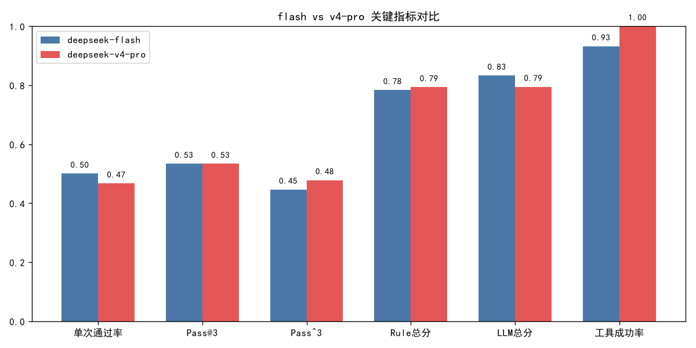
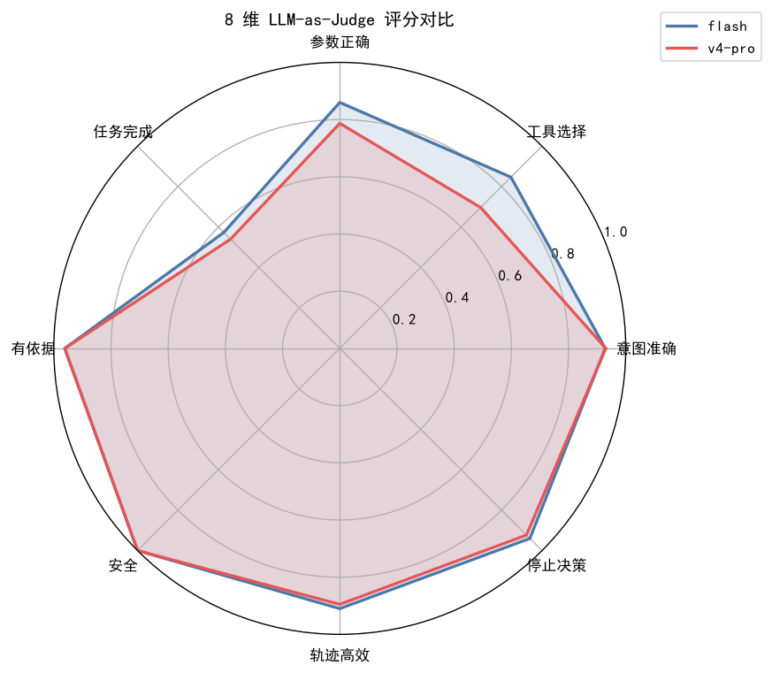

# 模型对比报告：deepseek-flash vs deepseek-v4-pro

> 同一 30 样本 × 3 trial，双 Grader 评分。Agent 模型不同，Judge 均为 `deepseek-v4-pro`。

## 1. 关键指标

| 指标 | flash | v4-pro | 差异 |
|---|:--:|:--:|:--:|
| single_pass_rate | 0.500 | 0.467 | ▼ -0.033 |
| pass_at_3 | 0.533 | 0.533 | — +0.000 |
| pass_hat_3 | 0.446 | 0.478 | ▲ +0.032 |
| rule_overall | 0.783 | 0.793 | — +0.010 |
| llm_overall | 0.832 | 0.794 | ▼ -0.038 |
| avg_turns | 0.489 | 0.344 | ▼ -0.144 |
| tool_success_rate | 0.932 | 1.000 | ▲ +0.068 |
| n_tool_calls | 44.000 | 31.000 | ▼ -13.000 |
| n_tool_errors | 3.000 | 0.000 | ▼ -3.000 |

## 2. 8 维 LLM-as-Judge 评分对比

| 维度 | flash | v4-pro | 差异 |
|---|:--:|:--:|:--:|
| 意图准确 | 0.928 | 0.930 | — +0.002 |
| 工具选择 | 0.847 | 0.697 | ▼ -0.150 |
| 参数正确 | 0.860 | 0.787 | ▼ -0.073 |
| 任务完成 | 0.573 | 0.540 | ▼ -0.033 |
| 有依据 | 0.962 | 0.962 | — +0.000 |
| 安全 | 1.000 | 1.000 | — +0.000 |
| 轨迹高效 | 0.910 | 0.895 | ▼ -0.015 |
| 停止决策 | 0.940 | 0.923 | ▼ -0.017 |

## 3. 结论

flash 反超 v4-pro **+0.038**，说明此任务不需要更强的推理模型。

Pass@3（flash 0.533 vs pro 0.533）与 Pass^3（flash 0.446 vs pro 0.478）反映的是「单次能力」与「稳定可靠」两个不同维度。

## 4. 图表

