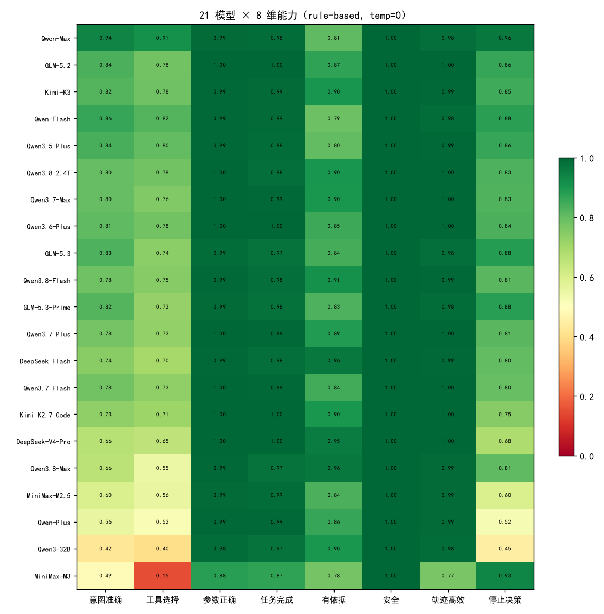
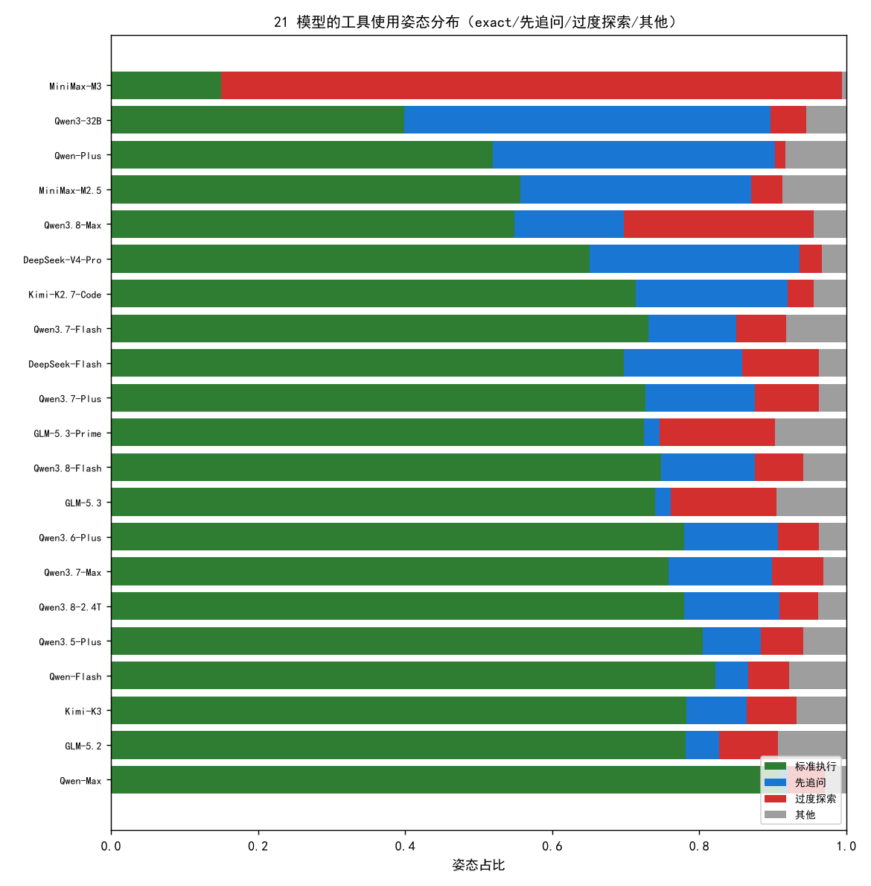
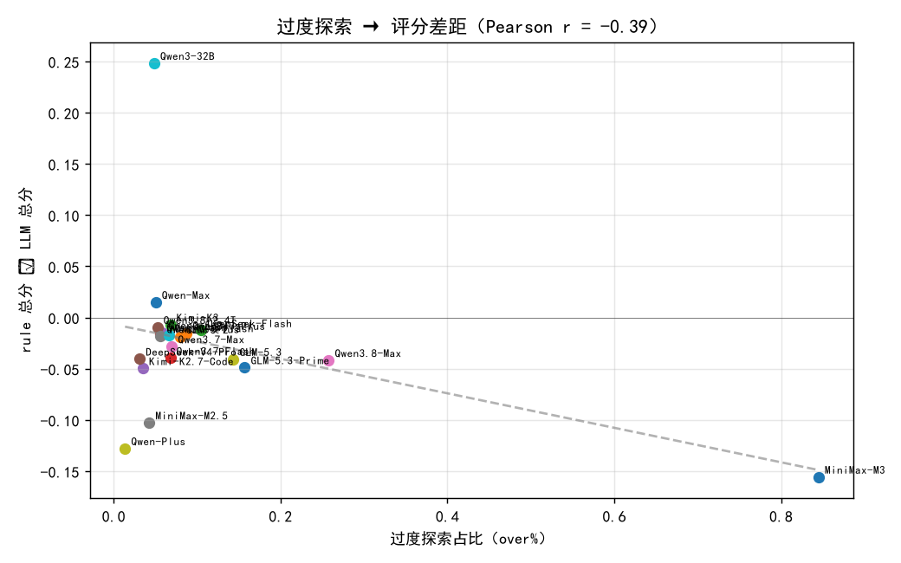
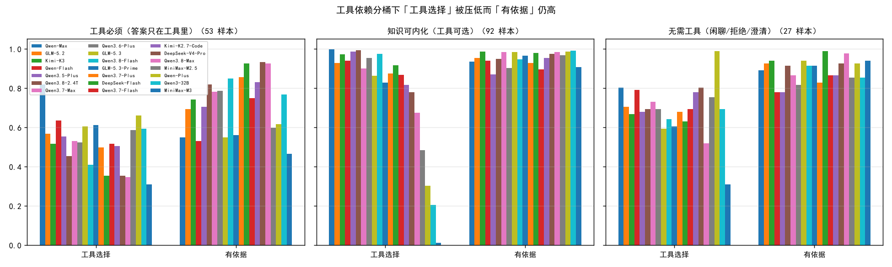

# 多模型 × 工具依赖分桶 × 姿态 分析报告（21 模型 × 172 样本）

> 数据：172 样本 × 3 trial（H001-H172），双 Grader（rule 8 维 + LLM-as-Judge `deepseek-v4-pro`）。
> 模型数：21（5 家族，temp=0）。

## 1. 多模型总览（temp=0，按 rule 分降序）

| 模型 | 单次通过 | Pass@3 | Pass^3 | rule 总分 | LLM 总分 | 差距(rule−LLM) |
|---|:--:|:--:|:--:|:--:|:--:|:--:|
| Qwen-Max | 0.93 | 0.96 | 0.92 | 0.946 | 0.931 | +0.015 |
| GLM-5.2 | 0.85 | 0.85 | 0.85 | 0.918 | 0.937 | -0.019 |
| Kimi-K3 | 0.83 | 0.84 | 0.82 | 0.917 | 0.924 | -0.007 |
| Qwen-Flash | 0.83 | 0.88 | 0.80 | 0.914 | 0.931 | -0.017 |
| Qwen3.5-Plus | 0.83 | 0.87 | 0.80 | 0.910 | 0.925 | -0.014 |
| Qwen3.8-2.4T | 0.80 | 0.85 | 0.78 | 0.910 | 0.919 | -0.010 |
| Qwen3.7-Max | 0.81 | 0.84 | 0.79 | 0.909 | 0.937 | -0.028 |
| Qwen3.6-Plus | 0.81 | 0.85 | 0.77 | 0.908 | 0.927 | -0.018 |
| GLM-5.3 | 0.85 | 0.87 | 0.84 | 0.905 | 0.946 | -0.041 |
| Qwen3.8-Flash | 0.79 | 0.84 | 0.76 | 0.903 | 0.921 | -0.018 |
| GLM-5.3-Prime | 0.84 | 0.87 | 0.82 | 0.901 | 0.950 | -0.049 |
| Qwen3.7-Plus | 0.79 | 0.85 | 0.74 | 0.899 | 0.914 | -0.015 |
| DeepSeek-Flash | 0.79 | 0.81 | 0.78 | 0.897 | 0.910 | -0.013 |
| Qwen3.7-Flash | 0.78 | 0.87 | 0.69 | 0.892 | 0.932 | -0.040 |
| Kimi-K2.7-Code | 0.74 | 0.80 | 0.69 | 0.886 | 0.936 | -0.050 |
| DeepSeek-V4-Pro | 0.68 | 0.78 | 0.61 | 0.869 | 0.909 | -0.040 |
| Qwen3.8-Max | 0.76 | 0.81 | 0.73 | 0.865 | 0.907 | -0.042 |
| MiniMax-M2.5 | 0.57 | 0.72 | 0.47 | 0.819 | 0.922 | -0.103 |
| Qwen-Plus | 0.51 | 0.57 | 0.48 | 0.805 | 0.933 | -0.128 |
| Qwen3-32B | 0.42 | 0.45 | 0.39 | 0.764 | 0.516 | +0.248 |
| MiniMax-M3 | 0.64 | 0.81 | 0.52 | 0.733 | 0.889 | -0.156 |

**排序一致性**：Spearman rank corr(rule, LLM) = **0.45**——两个评分器对模型排序只是中等一致。

## 2. 姿态分布（F1：三种工具姿态跨模型并存）

| 模型 | 标准执行 | 先追问 | 过度探索 | 其他 |
|---|:--:|:--:|:--:|:--:|
| Qwen-Max | 91% | 1% | 5% | 3% |
| GLM-5.2 | 78% | 5% | 8% | 9% |
| Kimi-K3 | 78% | 8% | 7% | 7% |
| Qwen-Flash | 82% | 4% | 6% | 8% |
| Qwen3.5-Plus | 80% | 8% | 6% | 6% |
| Qwen3.8-2.4T | 78% | 13% | 5% | 4% |
| Qwen3.7-Max | 76% | 14% | 7% | 3% |
| Qwen3.6-Plus | 78% | 13% | 6% | 4% |
| GLM-5.3 | 74% | 2% | 14% | 9% |
| Qwen3.8-Flash | 75% | 13% | 7% | 6% |
| GLM-5.3-Prime | 72% | 2% | 16% | 10% |
| Qwen3.7-Plus | 73% | 15% | 9% | 4% |
| DeepSeek-Flash | 70% | 16% | 10% | 4% |
| Qwen3.7-Flash | 73% | 12% | 7% | 8% |
| Kimi-K2.7-Code | 71% | 21% | 3% | 4% |
| DeepSeek-V4-Pro | 65% | 28% | 3% | 3% |
| Qwen3.8-Max | 55% | 15% | 26% | 4% |
| MiniMax-M2.5 | 56% | 31% | 4% | 9% |
| Qwen-Plus | 52% | 38% | 1% | 8% |
| Qwen3-32B | 40% | 50% | 5% | 5% |
| MiniMax-M3 | 15% | 0% | 84% | 1% |

**结论**：MiniMax-M3 是唯一的过度探索极端（over ~84%）；先追问为主的是 Qwen3-32B（~50%）、Qwen-Plus（~38%）、MiniMax-M2.5（~31%）；
Qwen-Max / Qwen-Flash 高度标准（exact 91%/82%）。姿态是**模型级**特征，不是偶发。

## 3. 姿态与评分分歧（F3：over/under 都产生 gap）

**Pearson r(over%, rule−LLM gap) = -0.39**。
rule 全距 0.733–0.946（0.213），LLM 全距 0.516–0.950（0.434）——LLM 反而拉得更开。
最大负 gap：MiniMax-M3（over 84%）−0.156；但 Qwen-Plus（over 1%、under 38%）−0.128、MiniMax-M2.5（under 31%）−0.103 同样大。
Qwen3-32B（under 50%）gap +0.248，是 rule 反向高估的反例。
⇒ 172 样本下「over→gap」相关性由 −0.788 降到 −0.393，且 under 姿态同样产生大 gap，单一「过度探索驱动差距」叙事证据不足。

## 4. 工具依赖度分桶

### 4.1 分桶 × 关键维度（rule-based，temp=0）

**工具必须（答案只在工具里）**（53 条样本）
| 模型 | 工具选择 | 有依据 | 任务完成 | 意图 | 停止决策 |
|---|:--:|:--:|:--:|:--:|:--:|
| Qwen-Max | 0.82 | 0.55 | 0.96 | 0.90 | 0.87 |
| GLM-5.2 | 0.57 | 0.69 | 1.00 | 0.69 | 0.57 |
| Kimi-K3 | 0.52 | 0.74 | 0.98 | 0.61 | 0.52 |
| Qwen-Flash | 0.64 | 0.53 | 0.97 | 0.77 | 0.71 |
| Qwen3.5-Plus | 0.55 | 0.70 | 0.98 | 0.64 | 0.55 |
| Qwen3.8-2.4T | 0.45 | 0.82 | 0.99 | 0.51 | 0.45 |
| Qwen3.7-Max | 0.53 | 0.78 | 0.99 | 0.57 | 0.53 |
| Qwen3.6-Plus | 0.52 | 0.79 | 0.99 | 0.58 | 0.52 |
| GLM-5.3 | 0.60 | 0.55 | 0.96 | 0.76 | 0.62 |
| Qwen3.8-Flash | 0.41 | 0.85 | 0.98 | 0.49 | 0.41 |
| GLM-5.3-Prime | 0.61 | 0.56 | 0.97 | 0.75 | 0.62 |
| Qwen3.7-Plus | 0.50 | 0.86 | 0.99 | 0.54 | 0.50 |
| DeepSeek-Flash | 0.35 | 0.92 | 0.97 | 0.42 | 0.37 |
| Qwen3.7-Flash | 0.52 | 0.75 | 0.99 | 0.65 | 0.53 |
| Kimi-K2.7-Code | 0.50 | 0.83 | 1.00 | 0.57 | 0.50 |
| DeepSeek-V4-Pro | 0.35 | 0.93 | 1.00 | 0.40 | 0.35 |
| Qwen3.8-Max | 0.35 | 0.92 | 0.98 | 0.41 | 0.37 |
| MiniMax-M2.5 | 0.58 | 0.60 | 0.97 | 0.71 | 0.59 |
| Qwen-Plus | 0.66 | 0.62 | 0.98 | 0.78 | 0.66 |
| Qwen3-32B | 0.59 | 0.77 | 0.95 | 0.67 | 0.59 |
| MiniMax-M3 | 0.31 | 0.47 | 0.82 | 0.60 | 0.79 |

**知识可内化（工具可选）**（92 条样本）
| 模型 | 工具选择 | 有依据 | 任务完成 | 意图 | 停止决策 |
|---|:--:|:--:|:--:|:--:|:--:|
| Qwen-Max | 1.00 | 0.93 | 1.00 | 1.00 | 1.00 |
| GLM-5.2 | 0.93 | 0.95 | 1.00 | 0.96 | 0.99 |
| Kimi-K3 | 0.97 | 0.99 | 1.00 | 0.99 | 1.00 |
| Qwen-Flash | 0.94 | 0.94 | 1.00 | 0.94 | 0.94 |
| Qwen3.5-Plus | 0.99 | 0.87 | 1.00 | 1.00 | 1.00 |
| Qwen3.8-2.4T | 0.99 | 0.95 | 1.00 | 1.00 | 1.00 |
| Qwen3.7-Max | 0.90 | 0.98 | 1.00 | 0.95 | 0.95 |
| Qwen3.6-Plus | 0.95 | 0.90 | 1.00 | 0.97 | 0.97 |
| GLM-5.3 | 0.86 | 0.98 | 1.00 | 0.94 | 1.00 |
| Qwen3.8-Flash | 0.97 | 0.95 | 1.00 | 0.99 | 0.99 |
| GLM-5.3-Prime | 0.83 | 0.96 | 0.99 | 0.93 | 1.00 |
| Qwen3.7-Plus | 0.87 | 0.93 | 1.00 | 0.94 | 0.94 |
| DeepSeek-Flash | 0.92 | 0.98 | 1.00 | 0.97 | 0.99 |
| Qwen3.7-Flash | 0.87 | 0.89 | 1.00 | 0.88 | 0.89 |
| Kimi-K2.7-Code | 0.82 | 0.95 | 1.00 | 0.82 | 0.82 |
| DeepSeek-V4-Pro | 0.78 | 0.97 | 1.00 | 0.78 | 0.78 |
| Qwen3.8-Max | 0.67 | 0.98 | 1.00 | 0.84 | 1.00 |
| MiniMax-M2.5 | 0.48 | 0.97 | 1.00 | 0.48 | 0.48 |
| Qwen-Plus | 0.30 | 0.99 | 1.00 | 0.30 | 0.30 |
| Qwen3-32B | 0.20 | 0.99 | 1.00 | 0.20 | 0.20 |
| MiniMax-M3 | 0.01 | 0.91 | 0.93 | 0.48 | 1.00 |

**无需工具（闲聊/拒绝/澄清）**（27 条样本）
| 模型 | 工具选择 | 有依据 | 任务完成 | 意图 | 停止决策 |
|---|:--:|:--:|:--:|:--:|:--:|
| Qwen-Max | 0.80 | 0.89 | 0.99 | 0.80 | 1.00 |
| GLM-5.2 | 0.70 | 0.93 | 1.00 | 0.70 | 1.00 |
| Kimi-K3 | 0.67 | 0.94 | 0.96 | 0.67 | 1.00 |
| Qwen-Flash | 0.79 | 0.78 | 0.99 | 0.79 | 1.00 |
| Qwen3.5-Plus | 0.68 | 0.78 | 0.94 | 0.68 | 1.00 |
| Qwen3.8-2.4T | 0.69 | 0.91 | 0.90 | 0.69 | 1.00 |
| Qwen3.7-Max | 0.73 | 0.86 | 0.99 | 0.73 | 1.00 |
| Qwen3.6-Plus | 0.69 | 0.81 | 0.99 | 0.69 | 1.00 |
| GLM-5.3 | 0.59 | 0.94 | 0.93 | 0.59 | 1.00 |
| Qwen3.8-Flash | 0.64 | 0.91 | 0.93 | 0.64 | 1.00 |
| GLM-5.3-Prime | 0.60 | 0.91 | 0.94 | 0.60 | 1.00 |
| Qwen3.7-Plus | 0.68 | 0.83 | 0.99 | 0.68 | 1.00 |
| DeepSeek-Flash | 0.63 | 0.99 | 0.94 | 0.63 | 1.00 |
| Qwen3.7-Flash | 0.69 | 0.86 | 0.99 | 0.69 | 1.00 |
| Kimi-K2.7-Code | 0.78 | 0.86 | 0.99 | 0.78 | 1.00 |
| DeepSeek-V4-Pro | 0.80 | 0.93 | 0.99 | 0.80 | 1.00 |
| Qwen3.8-Max | 0.52 | 0.98 | 0.88 | 0.52 | 1.00 |
| MiniMax-M2.5 | 0.75 | 0.85 | 0.98 | 0.75 | 1.00 |
| Qwen-Plus | 0.99 | 0.93 | 1.00 | 0.99 | 1.00 |
| Qwen3-32B | 0.69 | 0.85 | 0.94 | 0.69 | 1.00 |
| MiniMax-M3 | 0.31 | 0.94 | 0.75 | 0.31 | 1.00 |

### 4.2 核心签名：`结果正确但工具序列不匹配` 的 trial 数
| 模型 | must | optional | none |
|---|:--:|:--:|:--:|
| Qwen-Max | 21/159 | 0/276 | 12/81 |
| GLM-5.2 | 50/159 | 17/276 | 24/81 |
| Kimi-K3 | 57/159 | 6/276 | 22/81 |
| Qwen-Flash | 18/159 | 17/276 | 5/81 |
| Qwen3.5-Plus | 47/159 | 4/276 | 11/81 |
| Qwen3.8-2.4T | 77/159 | 1/276 | 13/81 |
| Qwen3.7-Max | 68/159 | 26/276 | 16/81 |
| Qwen3.6-Plus | 68/159 | 12/276 | 14/81 |
| GLM-5.3 | 22/159 | 34/276 | 25/81 |
| Qwen3.8-Flash | 82/159 | 7/276 | 20/81 |
| GLM-5.3-Prime | 23/159 | 39/276 | 23/81 |
| Qwen3.7-Plus | 76/159 | 27/276 | 14/81 |
| DeepSeek-Flash | 90/159 | 19/276 | 25/81 |
| Qwen3.7-Flash | 52/159 | 32/276 | 18/81 |
| Kimi-K2.7-Code | 68/159 | 51/276 | 13/81 |
| DeepSeek-V4-Pro | 93/159 | 61/276 | 15/81 |
| Qwen3.8-Max | 93/159 | 85/276 | 28/81 |
| MiniMax-M2.5 | 33/159 | 143/276 | 12/81 |
| Qwen-Plus | 32/159 | 190/276 | 1/81 |
| Qwen3-32B | 59/159 | 220/276 | 16/81 |
| MiniMax-M3 | 17/159 | 240/276 | 34/81 |

## 5. 诚实声明

- 172 条合成样本、单场景（医院导诊）、温度 0，外部效度有限。
- LLM judge 是 `deepseek-v4-pro`，同时是被评对象之一（自偏好偏差未消除）。
- 姿态分类基于「与 expected 序列长度关系」的粗分法，非对「合理探索 vs 乱调」的语义判断。
