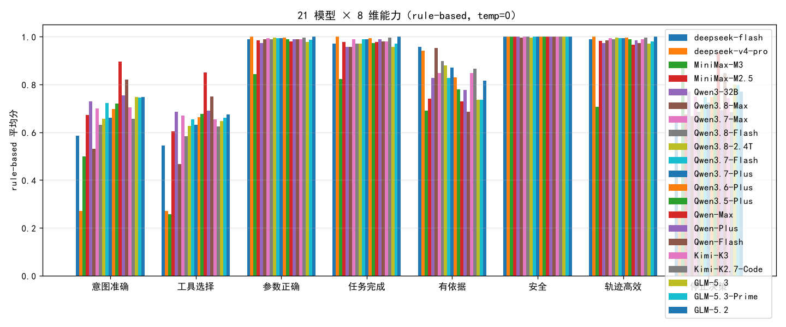
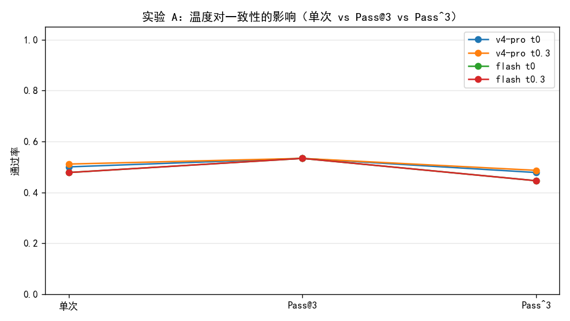

# 多模型 × 温度 × 工具依赖分桶 分析报告

> 数据：30 样本 × 3 trial，双 Grader（rule 8 维 + LLM-as-Judge）。
> 三模型：deepseek-flash / deepseek-v4-pro / MiniMax-M3；温度 0 与 0.3。

## 1. 多模型总览（temp=0）

| 模型 | 单次通过 | Pass@3 | Pass^3 | rule 总分 | LLM 总分 |
|---|:--:|:--:|:--:|:--:|:--:|
| deepseek-flash | 0.48 | 0.53 | 0.45 | 0.78 | 0.83 |
| deepseek-v4-pro | 0.50 | 0.53 | 0.48 | 0.79 | 0.79 |
| MiniMax-M3 | 0.31 | 0.40 | 0.24 | 0.64 | 0.75 |

### 8 维对比（rule-based）
| 维度 | deepseek-flash | deepseek-v4-pro | MiniMax-M3 |
|---|:--:|:--:|:--:|
| 意图准确 | 0.50 | 0.51 | 0.35 |
| 工具选择 | 0.47 | 0.47 | 0.13 |
| 参数正确 | 0.97 | 1.00 | 0.78 |
| 任务完成 | 0.91 | 1.00 | 0.78 |
| 有依据 | 0.89 | 0.87 | 0.74 |
| 安全 | 1.00 | 1.00 | 1.00 |
| 轨迹高效 | 0.97 | 1.00 | 0.61 |
| 停止决策 | 0.57 | 0.50 | 0.76 |

## 2. 实验 A：温度与一致性

| 配置 | 单次通过 | Pass@3 | Pass^3 | 差距(Pass@3−Pass^3) |
|---|:--:|:--:|:--:|:--:|
| v4-pro t0 | 0.50 | 0.53 | 0.48 | +0.06 |
| v4-pro t0.3 | 0.51 | 0.53 | 0.49 | +0.05 |
| flash t0 | 0.48 | 0.53 | 0.45 | +0.09 |
| flash t0.3 | 0.48 | 0.53 | 0.45 | +0.09 |

**解读**：温度=0 时 trial 高度确定，单次≈Pass@3≈Pass^3；
温度>0 引入真实随机性后，Pass@3（至少一次成功）与 Pass^3（三次全成功）显著拉开，
单次通过率不再能代表「稳定可靠」。这直接回答 RQ3。

## 3. 实验 B：工具依赖度分桶（揭示「能力-评测悖论」）

### 3.1 分桶 × 关键维度（rule-based，temp=0）

**工具必须（答案只在工具里）**（18 条样本）
| 模型 | 工具选择 | 有依据 | 任务完成 | 意图 | 停止决策 |
|---|:--:|:--:|:--:|:--:|:--:|
| flash | 0.28 | 0.83 | 0.93 | 0.33 | 0.28 |
| v4-pro | 0.19 | 0.85 | 1.00 | 0.26 | 0.19 |
| MiniMax-M3 | 0.11 | 0.61 | 0.74 | 0.40 | 0.59 |

**知识可内化（工具可选）**（3 条样本）
| 模型 | 工具选择 | 有依据 | 任务完成 | 意图 | 停止决策 |
|---|:--:|:--:|:--:|:--:|:--:|
| flash | 1.00 | 1.00 | 1.00 | 1.00 | 1.00 |
| v4-pro | 0.89 | 0.89 | 1.00 | 0.89 | 0.89 |
| MiniMax-M3 | 0.00 | 0.89 | 0.78 | 0.43 | 1.00 |

**无需工具（闲聊/拒绝/澄清）**（9 条样本）
| 模型 | 工具选择 | 有依据 | 任务完成 | 意图 | 停止决策 |
|---|:--:|:--:|:--:|:--:|:--:|
| flash | 0.67 | 0.96 | 0.85 | 0.67 | 1.00 |
| v4-pro | 0.89 | 0.89 | 1.00 | 0.89 | 1.00 |
| MiniMax-M3 | 0.22 | 0.96 | 0.85 | 0.22 | 1.00 |

### 3.2 核心信号：`结果正确但工具序列不匹配` 的 trial 数
> 签名 = 有依据=1 且 任务完成=1 且 工具选择=0。
> 注意：工具选择=0 表示「实际序列 != 期望序列」，含三种姿态——零工具追问(under)/额外工具(over)/错误工具(other)，
>       **并非**「跳过工具」。该签名量化的是「结果对、但过程被精确序列匹配判错」的比例。
| 模型 | must | optional | none |
|---|:--:|:--:|:--:|
| flash | 29/54 | 0/9 | 4/27 |
| v4-pro | 36/54 | 1/9 | 3/27 |
| MiniMax-M3 | 15/54 | 6/9 | 16/27 |

**结论**：
- 三模型都不存在「知识内化后跳过工具」——must 桶不调工具必虚构（有依据=0），该签名几乎不出现。
- 真正的问题是**工具使用姿态多样性**：先追问(under)、过度探索(over) 都是「结果对但偏离标准序列」，
  被「工具选择」的精确匹配一律判 0，导致规则分与 LLM 分在过程维度上大幅背离。
- 修正方法：ground truth 只编码一条标准序列，无法容纳等价但不同的完成路径；
  应改用「结果正确 + 必要工具是否被调用」而非「精确序列」来评 must 桶，optional/none 桶关闭过程惩罚。

## 4. 诚实声明

- 30 条合成样本、单场景、温度 0/0.3，样本量不足以做统计显著性判断。
- v4-pro 既当 Agent 又当 Judge，存在自偏好偏差；LLM 总分仅作相对参考。
- optional 桶仅 3 条样本（H001-H003），结论是方向性证据，需扩样本验证。
